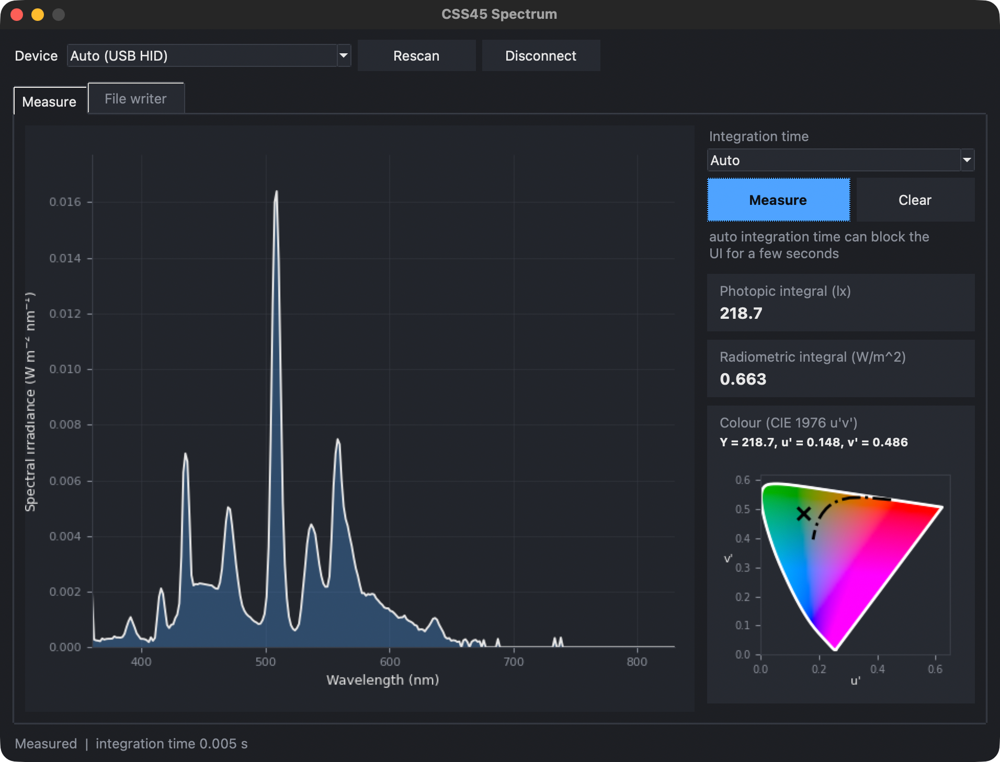

# pycss45

Clean, typed, object-oriented Python driver for the **Gigahertz-Optik CSS45**
compact spectrometer (MSC15 device family, 288-pixel spectral unit). It speaks
the device's ASCII protocol directly over USB HID - reverse-engineered from the
vendor's DLLs and **verified on live hardware** - so it runs on **Linux, macOS
and Windows** with no vendor DLL.

- **Cross-platform:** hidapi for USB HID, pyserial for RS232/RS485.
- **Small:** one module; `numpy`, `pyserial` and `hidapi` are the only deps.
- **Typed:** full type annotations, frozen dataclasses, no implicit global state.
- **Errors, not return codes:** device errors raise `Css45Error` with the
  vendor's error-code table; a context manager closes the device.
- **Hardware-free tests:** 30 tests run on any OS without a device attached.

```
Vibe Code Alert: This project was implemented by Mistral Vibe!
```

## Install

```bash
pip install .
```

For the GUI too, install the pinned environment first:

```bash
pip install -r requirements.txt
pip install .
```

## Quick start

```python
from pycss45 import CSS45

with CSS45() as css:               # auto-discovers the CSS45 over USB HID
    print(css.get_serial_number(), css.get_firmware_version())
    m = css.measure()              # auto integration time
    print(m.cct)                   # K
    print(m.photopic, m.par)
```

Without the `with` block, close the connection yourself:

```python
from pycss45 import CSS45

css = CSS45()                      # auto-discovers the CSS45 over USB HID
print(css.get_serial_number(), css.get_firmware_version())
m = css.measure()                  # auto integration time
print(m.cct)                       # K
print(m.photopic, m.par)
css.disconnect()                   # release the device
```

The spectrum is a plain numpy array, so plotting is one line:

```python
import matplotlib.pyplot as plt

plt.plot(m.wavelengths, m.spectrum)   # nm vs W m^-2 nm^-1
plt.xlabel("wavelength (nm)")
plt.show()
```

Units are SI: nm, s, K, deg C, ms.

## API

| Area        | Methods                                                                                                                                                                                                                                                                                |
| ----------- | -------------------------------------------------------------------------------------------------------------------------------------------------------------------------------------------------------------------------------------------------------------------------------------- |
| Lifecycle   | `CSS45(transport="hid")` (default; also `"serial"`), `CSS45.find()` (lists USB HID devices), `disconnect()`, `connected()`, `with CSS45() as css:`                                                                                                                                     |
| Info        | `get_serial_number()`, `get_firmware_version()`, `get_status()` (device status word), `get_temperature()` (deg C)                                                                                                                                                                      |
| Measurement | `measure()` (auto), `measure_manual(IntegrationTime)` (index 0-18) - both return a `Measurement` (`wavelengths` nm, `spectrum`, `integration_time` s, `cct` K, `photopic`, `par`); `measure_dark_offset()`, `is_offset_invalid()`, `get_last_integration_time()` (s)                   |
| Spectrum    | `get_wl_mapping()` (nm, 288 values), `get_wl_borders()` (nm), `get_spectrum_by_pixel()`, `get_spectrum_interpolated(start_wl, delta_wl, n)` (nm), `get_radiometric_value(start_wl, end_wl)` (nm), `get_radiometric_unit()` (W or W/m2), `get_cct()` (K), `get_photopic()`, `get_par()` |

`measure()` returns a frozen `Measurement` dataclass; the `get_*` methods re-query
the device individually.

Methods with no wire command - `set_dynamic_dark_mode`, `get_offset_time`, the
pulse family (`measure_pulse`, `dequeue_pulse`, `abort_pulse`), the detector
info (`get_detector_type`, `get_detector_serial_number`) and `get_dll_version`
- are not available on this protocol.

## Good to know

- **Transports:** `"hid"` (default) speaks the device's ASCII protocol directly
  over USB HID via hidapi - Linux, macOS, Windows. `"serial"` uses pyserial for
  RS232/RS485 (framing defaults are conservative and vendor-config-unverified).
  Some methods (`set_dynamic_dark_mode`, `get_offset_time`, the pulse family,
  detector info) have no decoded wire command and are not available on this
  protocol.
- **VID/PID:** the CSS45 enumerates as USB VID `0x0C49`, PID `0x0010`
  (hardware-observed). VID/PID are fixed in the device firmware, so they are
  identical on every OS, but they are not guaranteed across device variants -
  pass `CSS45(vid=..., pid=...)` / `CSS45.find(vid=..., pid=...)` for other
  MSC15-family devices. On Linux the HID device may need a udev rule or root.
- **Hardware-verified:** connect/identity, auto and manual measurement, the
  288-pixel spectrum blocks, interpolated reads, CCT/photopic/PAR, wavelength
  borders (360-830 nm) all verified on a live CSS45 (fw 1.58, macOS); the
  remaining unknowns are listed in [PROTOCOL.md](PROTOCOL.md).
- **Integration time is automatic** by default (`measure()`). Use
  `measure_manual(IntegrationTime.MS10)` for a fixed index 0-18
  (12 us to 2.56 s, table in [PROTOCOL.md](PROTOCOL.md)).
- **Dark offset:** `measure_dark_offset()` measures the dark offset;
  `is_offset_invalid()` tells you when a stored offset must be re-measured.
  Check `get_status()`/`Css45Error` for warnings such as overload (25023)
  - positive codes never raise.

## GUI



`pycss45-gui` (or `python -m pycss45_gui`) is a minimal spectral viewer:
the device box lists the CSS45s found over USB HID (Rescan refreshes it), an
integration-time box offers Auto or any of the 19 fixed times (12 us to
2.56 s), and Measure plots the spectrum with the photopic integral (lx),
radiometric integral (W/m²), the CIE 1976 colour (Y, u′, v′) and its position
(×) in the u′v′ chromaticity diagram; Clear resets plot and values. The
**File writer** tab appends every measurement to a CSV file (one row per
measurement: timestamp, integration time, integrals, Y/u′/v′, then one
column per wavelength). The colour math is done with [colour-science] from the
measured spectrum, not from the device. There is no gain control - the
device auto-ranges (see PROTOCOL.md).

```bash
pip install matplotlib colour-science scipy    # extra deps for the GUI; Tk comes with Python
pycss45-gui
```

Pick **Demo** as the device to try the viewer without hardware. Measurement is
single-shot on the UI thread; the auto integration time can block it for a few
seconds.

For a scripted one-off measurement and plot there is `measure_spectrum.ipynb`
(needs jupyter).

[colour-science]: https://github.com/colour-science/colour

## Development

```bash
python3 -m unittest -v test_pycss45   # no hardware needed
```

[PROTOCOL.md](PROTOCOL.md) documents the reverse-engineered SDK surface: the DLL
inventory, all 99 exports and their signatures, error and warning codes, the
integration-time table, transports, and the bugs found in the vendor Python wrapper.

> The SDK surface was reverse-engineered from the vendor DLLs; the wire protocol
> is hardware-verified (see above). Written with AI assistance.

## License

MIT, see [LICENSE](LICENSE). Not affiliated with or endorsed by Gigahertz-Optik.
"Gigahertz-Optik", "CSS45" and "MSC15" are their trademarks. The SDK surface was
worked out from the vendor's DLLs and Python example.
